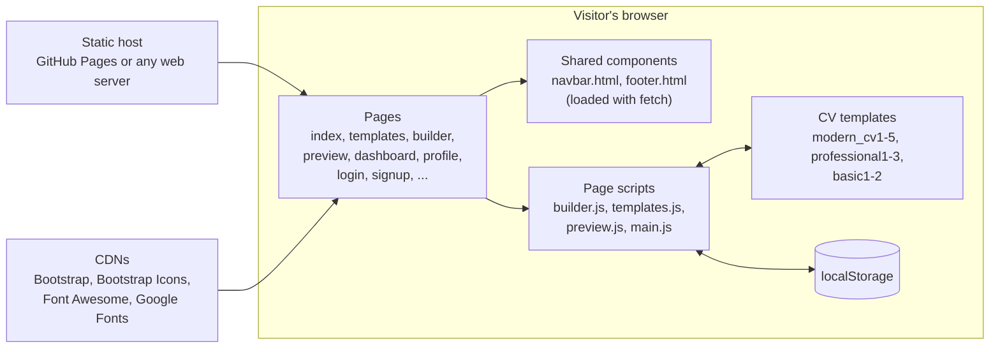
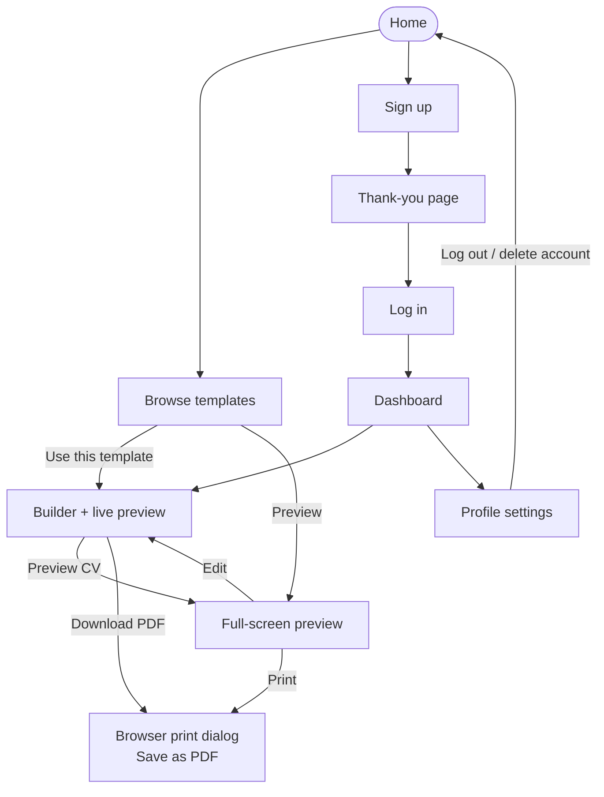
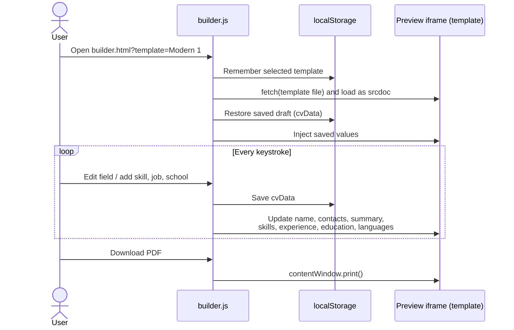
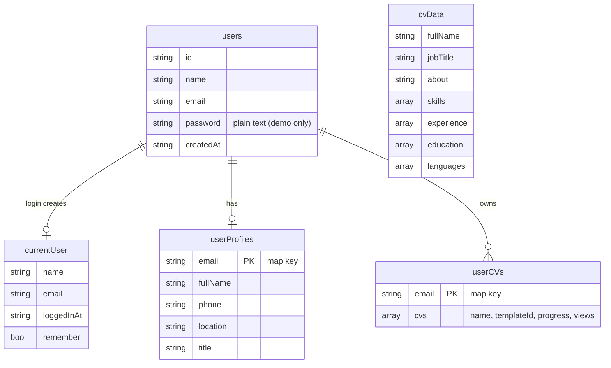

<div align="center">

# ResumeBuilder

**A browser-based CV builder: pick a template, fill in your details, watch the preview update live, and export to PDF.**


-lightgrey)


[**Live demo**](https://muntaha-shahab.github.io/ResumeBuilder-Web/) &nbsp;|&nbsp; [Features](#features) &nbsp;|&nbsp; [How it works](#how-it-works) &nbsp;|&nbsp; [Run locally](#getting-started)

</div>

---

## Table of Contents

- [Overview](#overview)
- [Features](#features)
- [Screenshots](#screenshots)
- [Templates](#templates)
- [How It Works](#how-it-works)
  - [Architecture](#architecture)
  - [User Journey](#user-journey)
  - [Builder Data Flow](#builder-data-flow)
  - [Browser Storage Model](#browser-storage-model)
- [Tech Stack](#tech-stack)
- [Project Structure](#project-structure)
- [Getting Started](#getting-started)
- [Deploying to GitHub Pages](#deploying-to-github-pages)
- [Scope and Limitations](#scope-and-limitations)
- [Roadmap](#roadmap)
- [Author](#author)
- [License](#license)

---

## Overview

ResumeBuilder is a multi-page, front-end web application for creating professional CVs. A visitor chooses one of **10 templates**, enters personal details, skills, experience, education and languages in the builder, and sees the chosen template update **in real time**. The finished CV can be previewed full-screen and exported to PDF through the browser's print dialog.

The project also includes a marketing site (home, about, pricing, FAQ, resume tips, contact), and an account area (sign up, log in, dashboard, profile settings).

It is built with plain **HTML, CSS and JavaScript** plus Bootstrap. There is no build step and no server code, so it runs from any static host.

## Features

| Area | What you get |
|---|---|
| **Template gallery** | 10 CV designs in three families (Modern, Professional, Basic) with preview and "use this template" actions |
| **CV builder** | Form for personal info, summary, skills (with proficiency level), work experience, education and languages |
| **Live preview** | The selected template re-renders in an embedded frame as you type |
| **Autosave** | Draft data is saved in the browser as you edit; Save Draft and Reset buttons included |
| **Full-screen preview** | Dedicated preview page with Edit and Print actions |
| **PDF export** | Download PDF opens the template's print dialog so it can be saved as PDF |
| **Accounts (demo)** | Sign up, log in, remember-me, log out, and route protection for the dashboard |
| **Dashboard** | Welcome view with CV cards, progress, and quick actions |
| **Profile settings** | Personal information, social profiles, security, notifications, display preferences and plan sections |
| **Marketing pages** | Home, About, Pricing, FAQ, Resume Tips, Contact and a custom 404 |
| **Shared layout** | Bootstrap-based pages with a common navbar and footer loaded as components |

## Screenshots

<!--
Add your own screenshots to docs/screenshots/ and uncomment this block.
Suggested names: home.png, templates.png, builder.png, dashboard.png

| Home | Templates |
|:---:|:---:|
|  |  |

| Builder with live preview | Dashboard |
|:---:|:---:|
|  |  |
-->

_Screenshots coming soon. Try the [live demo](https://muntaha-shahab.github.io/ResumeBuilder-Web/) in the meantime._

## Templates

| Family | Templates | File names |
|---|---|---|
| Modern | Modern 1 to Modern 5 | `modern_cv1.html` ... `modern_cv5.html` |
| Professional | Professional 1 to Professional 3 | `professional1.html` ... `professional3.html` |
| Basic | Basic 1 and Basic 2 | `basic1.html`, `basic2.html` |

Every template is a standalone HTML page, so adding a new one means creating the page and registering its name in the template maps in `js/builder.js`, `js/templates.js` and `js/preview.js`.

## How It Works

### Architecture

Everything runs in the visitor's browser. Shared UI (navbar and footer) is fetched at runtime, state lives in `localStorage`, and styling libraries come from public CDNs.



### User Journey



### Builder Data Flow

When you type in the form, the app saves the draft and writes the values straight into the template that is shown in the preview frame.



### Browser Storage Model

There is no database. The app keeps its data in these `localStorage` keys:



`selectedTemplate` and `selectedTemplateFile` store the chosen template, and `cvData` holds the single in-progress draft used by the builder.

## Tech Stack

| Layer | Technology |
|---|---|
| Markup and styling | HTML5, CSS3 with custom properties, Bootstrap 5.3 |
| Behaviour | Vanilla JavaScript (ES6), Fetch API, Web Storage API |
| Icons and fonts | Bootstrap Icons, Font Awesome 6, Google Fonts (Inter, Plus Jakarta Sans) |
| Export | Browser print engine (Save as PDF) |
| Hosting | Any static host, for example GitHub Pages |

## Project Structure

```text
ResumeBuilder-Web/
├── index.html              # Landing page
├── templates.html          # Template gallery
├── builder.html            # Form + live preview
├── preview.html            # Full-screen preview
├── dashboard.html          # Logged-in home
├── profile.html            # Account and profile settings
├── login.html / signup.html / thankyou.html
├── about.html / pricing.html / faq.html / resume-tips.html / contact.html / 404.html
├── modern_cv1.html ... modern_cv5.html        # Modern templates
├── professional1.html ... professional3.html  # Professional templates
├── basic1.html, basic2.html                   # Basic templates
├── components/
│   ├── navbar.html         # Shared navigation (fetched at runtime)
│   └── footer.html         # Shared footer (fetched at runtime)
├── css/                    # style, builder, templates, preview, modern_cv1-5
├── js/                     # main, builder, templates, preview, modern_cv1-5
├── LICENSE
└── README.md
```

## Getting Started

The shared navbar and footer are loaded with `fetch`, which browsers block on `file://` URLs. **Serve the folder over HTTP** instead of double-clicking `index.html`.

### Option A: VS Code Live Server (easiest)

1. Install the **Live Server** extension in VS Code.
2. Open the project folder.
3. Right-click `index.html` and choose **Open with Live Server**.

### Option B: Python

```bash
git clone https://github.com/Muntaha-Shahab/ResumeBuilder-Web.git
cd ResumeBuilder-Web
python -m http.server 8000
```

Then open <http://localhost:8000>.

### Option C: Node

```bash
npx serve .
```

An internet connection is needed on first load for the Bootstrap, icon and font CDNs.

## Deploying to GitHub Pages

1. Push the repository to GitHub.
2. Open **Settings > Pages**.
3. Under **Build and deployment**, set **Source** to **Deploy from a branch**, choose branch **main** and folder **/ (root)**, then **Save**.
4. After a minute the site is live at `https://<your-username>.github.io/ResumeBuilder-Web/`.

All asset paths in the project are relative, so the site works from a sub-path like this without changes.

## Scope and Limitations

This project is a **front-end prototype**. It is useful for demonstrating UI, templates and the builder experience, and it is clear about what it does not do:

- **No backend.** Accounts, profiles and CV data exist only in the current browser's `localStorage` and are not shared between devices.
- **Demo authentication.** Passwords are stored in plain text in `localStorage` and the "verification email" step is simulated. **Do not enter a real password.**
- **Dashboard CVs are sample data.** The dashboard seeds example CV cards; it is not yet connected to drafts created in the builder, which are stored as a single draft (`cvData`).
- **Pricing and billing are static.** The plans, payment and two-factor sections are interface mock-ups with no payment processing.
- **PDF export** uses the browser's print dialog, so the result depends on the browser's print settings.
- **Contact form** validates input but does not send messages anywhere.

## Roadmap

- [ ] Add a real backend (for example Firebase or Supabase) for secure authentication and cloud storage
- [ ] Connect builder drafts to the dashboard so users can save and reopen multiple CVs
- [ ] Generate PDFs directly (for example with `html2pdf.js`) instead of the print dialog
- [ ] Add profile photo upload and section reordering
- [ ] Add accessibility and responsive-layout audits, and automated tests
- [ ] Publish a screenshot gallery for each template

## Author

**Muntaha Shahab** &nbsp;·&nbsp; [@Muntaha-Shahab](https://github.com/Muntaha-Shahab)

## License

Distributed under the MIT License. See [`LICENSE`](LICENSE) for details.
